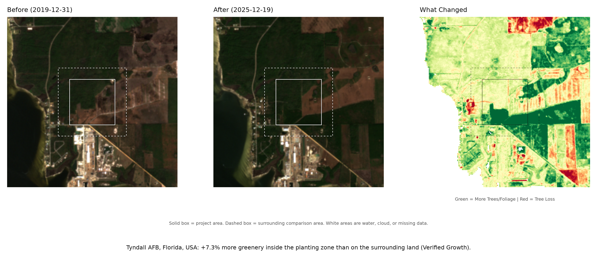
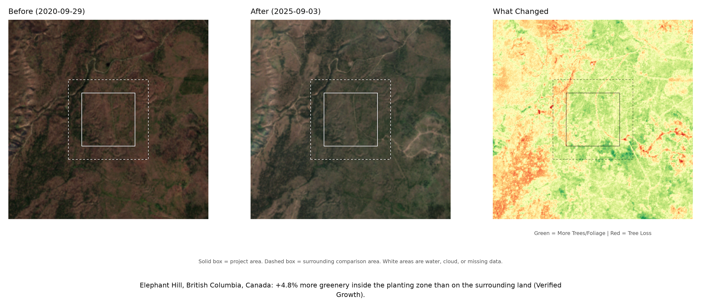
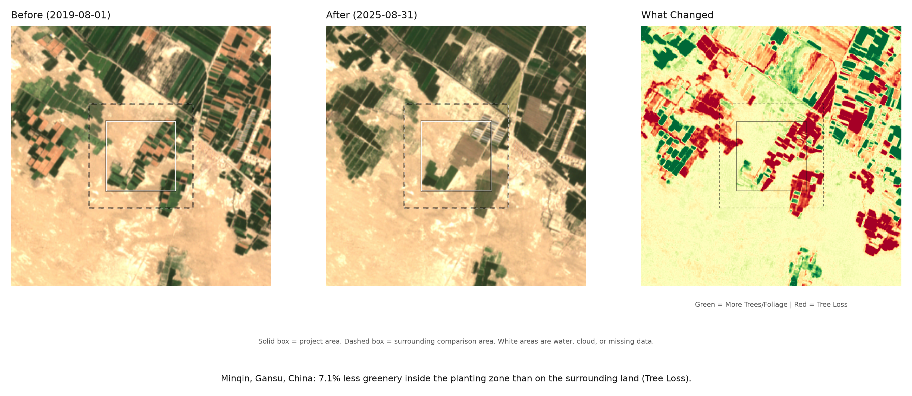
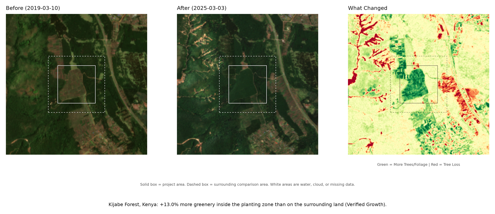
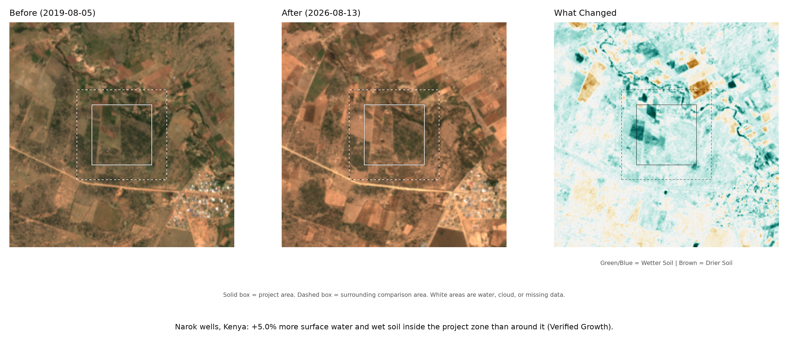
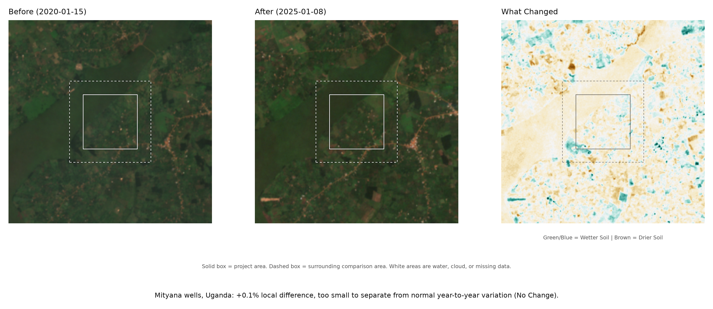
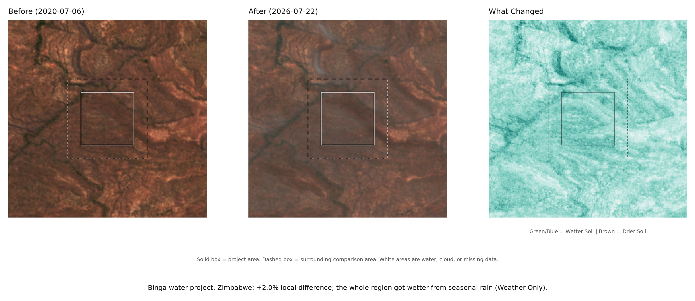
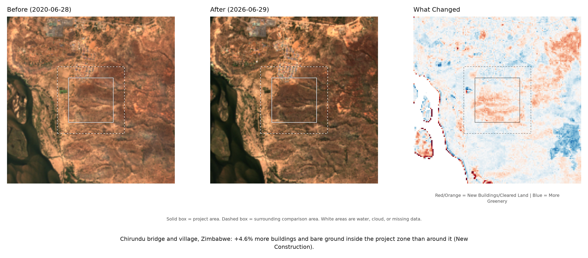
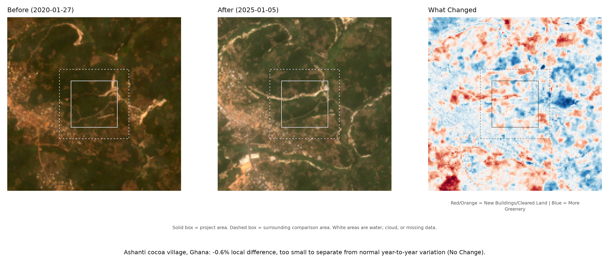
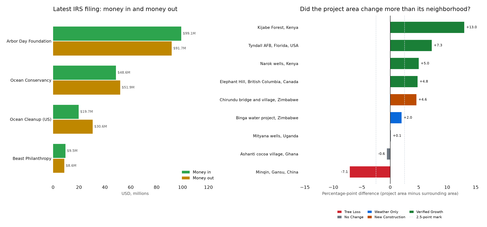

# Auditing the MrBeast Charity Machine: $100M Partner Reserves, Seven-Figure Executive Pay, and What Satellites Actually See

MrBeast's viral fundraisers (#TeamTrees, #TeamSeas, #TeamWater) and Beast Philanthropy videos have raised over $95 million from grassroots donors on a simple promise: one dollar equals one tree in the ground or one pound of trash out of the ocean. Wait long enough after the cameras leave, though, and the public record tells a much messier story:

* **Grassroots dollars feed $100M corporate cushions:** While Beast Philanthropy itself is a $9.5M operation (filing as *Mrcharity Inc*), the mega-campaigns route money to giant legacy nonprofits. IRS Form 990 filings show #TeamTrees partner Arbor Day Foundation sitting on **$100.9 million in net assets** while paying **$3.36 million a year** in executive compensation. #TeamSeas partner Ocean Conservancy holds **$81.0 million in reserves** and pays executives **$2.4M to $3.6M annually**.
* **Planting is filmed; survival is not:** At the North Carolina state park filmed for the flagship #TeamTrees launch video, on-the-ground counts found only **118 of 2,000 trees (6%) alive**, compared to Arbor Day's 97% survival pitch. In China's Minqin desert margin, satellite imagery recorded a **7.1-point drop in greenery** since planting began.
* **Five sponsors claiming the same green forest:** Even where satellite imagery confirms strong tree growth, like Kijabe Forest in Kenya (+13.0 points), charities refuse to publish GPS polygon maps (shapefiles) of their plots. As a result, at least **five separate global funders** (#TeamTrees, Ecosia, One Tree Planted, Mastercard's Priceless Planet, and UNDP) can point donors to the exact same greening hillside as proof of their own campaign.

## Why these projects

Beast Philanthropy's videos are built around before-and-after claims. Several of those claims have been disputed.

The #TeamTrees campaign raised more than $20 million and promised 20 million trees by the end of 2020. The launch video was filmed at a North Carolina park. Reported ground checks at that park found 118 of 2,000 planted trees alive, about 6%. The Arbor Day Foundation, which handled the planting, had projected 97% survival. A check at one park covers one planting round. The gap is still large. A video count records trees put in the ground. Survival is a separate number.

The #TeamWater campaign raised about $40 million and built 100 wells in Africa. Residents, local reporters, and online critics questioned whether every well still worked and who would pay for repairs. Public calls for an independent audit followed. The campaign's public material does not include a well-by-well maintenance record. A construction video shows a well being installed. It does not show the repair schedule for the next five years.

Former employees told Business Insider and Time that Feastables product placement was worked into aid-drop shoots. That is a business decision inside a charity video, and it is the kind of detail that makes a donation video look like an ad. Gizmodo criticized #TeamSeas as greenwashing, arguing that a cleanup campaign can draw attention away from the production of plastic. The cleanups took place. The criticism targets the campaign's framing and its silence on plastic production.

## What the money shows

ProPublica's Nonprofit Explorer extracts numbers from IRS Form 990 filings. The table includes the four most recent extracted years for each organization, using legal filer names where they differ from public brands.

| Organization | EIN | Fiscal year | Revenue | Expenses | Reported executive pay | Net assets at year end | Expenses as share of revenue |
| --- | --- | ---: | ---: | ---: | ---: | ---: | ---: |
| Beast Philanthropy | 85-2067214 | 2023 | $9,513,450 | $8,638,123 | $96,951 | $2,480,643 | 90.8% |
| Beast Philanthropy | 85-2067214 | 2022 | $10,155,691 | $8,968,669 | $94,716 | $1,605,316 | 88.3% |
| Beast Philanthropy | 85-2067214 | 2021 | $2,810,521 | $2,566,279 | $84,240 | $418,294 | 91.3% |
| Beast Philanthropy | 85-2067214 | 2020 | $469,150 | $242,437 | $0 | $226,713 | 51.7% |
| National Arbor Day Foundation | 23-7169265 | 2024 | $99,061,954 | $91,666,382 | $3,356,377 | $100,896,370 | 92.5% |
| National Arbor Day Foundation | 23-7169265 | 2023 | $97,035,028 | $85,958,857 | $3,118,003 | $92,602,143 | 88.6% |
| National Arbor Day Foundation | 23-7169265 | 2022 | $94,760,158 | $78,863,450 | $2,593,198 | $81,041,620 | 83.2% |
| National Arbor Day Foundation | 23-7169265 | 2021 | $89,090,344 | $75,187,856 | $1,984,804 | $66,784,404 | 84.4% |
| Ocean Conservancy | 23-7245152 | 2023 | $48,602,165 | $51,861,192 | $2,418,987 | $80,970,831 | 106.7% |
| Ocean Conservancy | 23-7245152 | 2022 | $49,652,396 | $40,853,139 | $3,655,926 | $80,749,273 | 82.3% |
| Ocean Conservancy | 23-7245152 | 2021 | $55,287,830 | $31,550,814 | $3,017,167 | $79,769,037 | 57.1% |
| Ocean Conservancy | 23-7245152 | 2020 | $33,767,304 | $32,093,986 | $2,629,498 | $48,969,047 | 95.0% |
| The Ocean Cleanup (US) | 81-5132355 | 2023 | $19,747,898 | $30,619,405 | $0 | $8,801,905 | 155.1% |
| The Ocean Cleanup (US) | 81-5132355 | 2022 | $36,740,334 | $23,744,670 | $0 | $19,673,412 | 64.6% |
| The Ocean Cleanup (US) | 81-5132355 | 2021 | $8,535,781 | $7,896,828 | $0 | $8,106,113 | 92.5% |
| The Ocean Cleanup (US) | 81-5132355 | 2020 | $4,270,344 | $85,306 | $0 | $7,467,160 | 2.0% |

The reported executive pay field covers current officers, directors, trustees, and key employees. It is not total payroll.

Beast Philanthropy files under the legal name Mrcharity Inc, EIN 85-2067214. In fiscal 2023 the organization reported $9.51 million in revenue, $8.64 million in expenses, and $2.48 million in net assets. Reported executive pay was $96,951, about 1.1% of expenses. Revenue fell from $10.16 million in fiscal 2022 to $9.51 million in fiscal 2023. Net assets rose by about $875,000 over the same period. ProPublica lists a fiscal 2024 filing but has not extracted its financial data, so the table stops at 2023.

The National Arbor Day Foundation reported $99.06 million in revenue and $91.67 million in expenses in fiscal 2024. It ended the year with $100.9 million in net assets, about 1.1 years of expenses. Reported executive pay was $3.36 million, about 3.7% of expenses. Arbor Day is the planting partner behind #TeamTrees, so its reserves and pay are part of the same campaign picture.

Ocean Conservancy reported $48.60 million in revenue and $51.86 million in expenses, so it spent more than it took in. It ended the year with $81.0 million in net assets, about 1.6 years of expenses. Reported executive pay was $2.42 million that year, $3.66 million in fiscal 2022, and $3.02 million in fiscal 2021. Ocean Conservancy is a partner in #TeamSeas.

The Ocean Cleanup (US) is the US affiliate, American Friends Of The Ocean Cleanup Foundation. It reported $19.75 million in revenue and $30.62 million in expenses in fiscal 2023, with $8.8 million in net assets and no reported executive pay in this field. The Dutch foundation that runs the cleanup operations is a separate legal entity and is not covered by this Form 990.

Viewers often treat MrBeast's charity drives as a single operation, but the money flows into organizations of very different scales. Beast Philanthropy itself is a $9.5 million charity that pays under $97,000 in executive compensation. By contrast, viral fundraisers like #TeamTrees and #TeamSeas routed donations directly to giant partner nonprofits like the Arbor Day Foundation ($99.1 million in annual revenue) and Ocean Conservancy ($48.6 million). Those partners sit on $81 million to $101 million in net reserves and pay $2.4 million to $3.6 million a year to their executives and key officers. Holding a year of reserves and paying seven-figure executive salaries is legal and does not constitute fraud under IRS rules, but it means grassroots $1 donations are flowing into massive institutions with large overhead and huge cash cushions.

## What the satellites show

Each site analysis uses a 3 km by 3 km window centered on the coordinates. An 800 m by 800 m box marks the approximate project area, compared against a surrounding control ring from 1.2 km to 3 km. A 200 m guard band separates the two so project edges do not bleed into the control zone. Sentinel-2 imagery evaluates the same spectral index on matching dates across both zones. The net local difference subtracts the ring change from the box change, using a 2.5-point shift as the threshold for a meaningful signal.

The three indices measure different things:

| Index | Plain meaning | Higher value means |
| --- | --- | --- |
| NDVI | Green leaves and vegetation cover | More greenery |
| NDWI | Surface water and wet soil | Wetter ground |
| NDBI | Built-up and bare ground | More buildings or cleared land |

Raw index values run from -1 to +1. Multiplying index changes by 100 converts them into points: a change of +0.05 appears as +5.0 points.

<!-- SLIDER_START -->

<b>[1/9] Tyndall AFB FL US</b>

<b>[2/9] Elephant Hill BC CA</b>

<b>[3/9] Minqin Gansu CN</b>

<b>[4/9] Kijabe Forest KE</b>

<b>[5/9] Narok Wells Cluster KE</b>

<b>[6/9] Mityana Wells Cluster UG</b>

<b>[7/9] Binga Water Project ZW</b>

<b>[8/9] Chirundu Bridge And Village ZW</b>

<b>[9/9] Ashanti Cocoa Village Zone GH</b>

<!-- SLIDER_END -->

| Site | Dates | Inside change | Ring change | Local difference | Result |
| --- | --- | ---: | ---: | ---: | --- |
| [Tyndall AFB, Florida, USA](visuals/01_Tyndall_AFB_FL_US.png) | 2019-12-31 to 2025-12-19 | +15.8 | +8.5 | +7.3 | Verified Growth |
| [Elephant Hill, British Columbia, Canada](visuals/02_Elephant_Hill_BC_CA.png) | 2020-09-29 to 2025-09-03 | +6.1 | +1.3 | +4.8 | Verified Growth |
| [Minqin, Gansu, China](visuals/03_Minqin_Gansu_CN.png) | 2019-08-01 to 2025-08-31 | -8.1 | -1.0 | -7.1 | Tree Loss |
| [Kijabe Forest, Kenya](visuals/04_Kijabe_Forest_KE.png) | 2019-03-10 to 2025-03-03 | +13.9 | +0.9 | +13.0 | Verified Growth |
| [Narok wells, Kenya](visuals/05_Narok_Wells_Cluster_KE.png) | 2019-08-05 to 2026-08-13 | +8.2 | +3.2 | +5.0 | Wetter Soil |
| [Mityana wells, Uganda](visuals/06_Mityana_Wells_Cluster_UG.png) | 2020-01-15 to 2025-01-08 | -2.1 | -2.2 | +0.1 | No Change |
| [Binga water project, Zimbabwe](visuals/07_Binga_Water_Project_ZW.png) | 2020-07-06 to 2026-07-22 | +13.2 | +11.2 | +2.0 | Weather Only |
| [Chirundu bridge and village, Zimbabwe](visuals/08_Chirundu_Bridge_And_Village_ZW.png) | 2020-06-28 to 2026-06-29 | +4.2 | -0.4 | +4.6 | More Built-Up |
| [Ashanti cocoa village, Ghana](visuals/09_Ashanti_Cocoa_Village_Zone_GH.png) | 2020-01-27 to 2025-01-05 | -1.2 | -0.6 | -0.6 | No Change |

Kijabe Forest is the clearest local gain. Greenery inside the box rose by 13.9 points while the ring rose by 0.9 points. The local difference is 13.0 points, well above the threshold. Both images are from March, which reduces seasonal bias. The result is still one pair of dates, not a five-year average.

Elephant Hill also clears the threshold, with a 4.8-point local gain.

Minqin moves the other way. Greenery inside the box fell by 8.1 points while the ring fell by 1.0 point. The local difference is -7.1 points, well below the threshold, and the plain label is Tree Loss. The site now sits on the desert edge west of town, among shelterbelts, fields, and bare sand. It is no longer the downtown street grid. A loss there can mean a dry year, a retired field, or cutting on the oasis margin. One scene pair cannot separate those causes. The result is a real local signal in the imagery, not proof that a project failed.

Binga shows why the ring matters. Wet-soil signal inside the inland rural box rose by 13.2 points. The surrounding ring rose by 11.2 points. The local difference is +2.0 points, which stays below the 2.5-point threshold. The whole district got wetter between the two July scenes, and the target zone moved only slightly more than its neighborhood. Moving the point inland from the Lake Kariba shoreline also removed lake-edge artifacts.

Narok, moved out of Narok town center into the rural agro-pastoral zone at -1.1450, 35.7450, clears the threshold. The inside change is +8.2 points and the ring change is +3.2 points, for a +5.0-point local gain. That indicates wetter soil or denser vegetation inside the rural box than in the surrounding fields, though a single August pair cannot tie that moisture directly to a borehole pump.

Mityana, set in a rural farming zone outside the town core at 0.4450, 31.9850, shows no clear local change. The inside change is -2.1 points and the ring change is -2.2 points, leaving a +0.1-point local difference. Drinking-water boreholes rarely alter surface moisture across an 800 m square unless they feed open field irrigation.

Chirundu, placed on fully terrestrial ground at -16.0550, 28.8650 away from the main Zambezi channel, shows a +4.2-point rise in built-up or bare-ground signal inside the core while the ring changed by -0.4 points. The +4.6-point local difference clears the threshold and is consistent with new cleared ground, roads, or roofs.

Ashanti now sits in a rural cocoa village zone northeast of Kumasi, not on the city center or the stadium. The inside change is -1.2 points on NDBI and the ring change is -0.6 points. The local difference is -0.6 points, inside the noise band, so the plain label is No Change. A negative NDBI change means less bare or built-up surface, but at this size it is too small to separate from scene noise.

Tyndall now sits on the interior pine tract at 30.0460, -85.4750, well inland from the old shoreline coordinate. The 800 m core is 100% land on both dates, with zero water pixels. Greenery inside the box rose by 15.8 points while the ring rose by 8.5 points. The local difference is +7.3 points, which clears the threshold and reads as Verified Growth.

The change map still has red patches. Hurricane Michael hit Tyndall in October 2018. The Air Force then spent several years on salvage logging, clearing downed and damaged timber. Bare ground and stacked logs register as spectral loss. Replanted longleaf pine stays in a low grass stage for its first several years, so a young stand can look sparse from above even when it is healthy. The 2019 baseline falls after the storm and during the salvage work, so the comparison starts from an unusually bare state.

The count is five sites with a verified local signal (three reforestation, one rural water, one infrastructure), one weather-only water site, two no-change sites, and one tree-loss site. The Minqin loss is a local signal on the oasis margin. It does not by itself show that a planting program failed.

## The attribution problem

A satellite image can show that a hillside got greener. It cannot show which donor paid for which seedling, and several funders often support the same local partner.

Kijabe Forest is the clearest example. The Kijabe Forest Trust carries out restoration there with the Kenya Forest Service. Public campaign and partner materials list at least five sources of support for work in the same forest:

1. The Arbor Day Foundation, through #TeamTrees, with a 250,000-tree commitment.
2. Ecosia, which has funded planting in Kijabe independently.
3. One Tree Planted.
4. The Mastercard Priceless Planet Coalition and Conservation International.
5. UNDP, the Global Environment Facility, and Kenyan government restoration grants.

Public materials do not include polygon-level shapefiles that assign each planted parcel to a specific grant. Without those boundaries, each sponsor can point to the same green hillside as evidence of its own campaign. The +13.0-point gain at Kijabe is visible in the imagery. Satellite imagery cannot divide the credit among the sponsors.

Tyndall has a similar overlap. Its reforestation is a federal effort led by the U.S. Air Force Wildland Fire Branch, the Air Force Civil Engineer Center, the Florida Forest Service, and the National Fish and Wildlife Foundation, alongside the Arbor Day Foundation. New pine cover in a satellite image cannot be assigned to one of those partners.

The overlap is normal in large restoration programs. It also limits what this audit can prove. A before-and-after image can confirm that work happened in a place, but it cannot assign a specific donation to a specific tree.

## Scope and Methodology Note

This audit relies on public IRS Form 990 tax filings (via ProPublica) and Copernicus Sentinel-2 Level-2A surface reflectance imagery (10 m resolution for NDVI/NDWI, 20 m for NDBI). To prevent regional rainy seasons from faking project success, each site compares an 800 m target core against a 1.2 km to 3.0 km surrounding control ring on same-month image pairs with water and clouds masked out. Because Beast Philanthropy and its partners do not publish exact GPS shapefiles for their planting or construction boundaries, target boxes represent approximate rural project zones. Spectral indices measure macro-scale surface reflectance rather than individual saplings or underground borehole flow rates, and reported media disputes reflect third-party journalism rather than court findings.

## Sources

- ProPublica Nonprofit Explorer: [Beast Philanthropy / Mrcharity Inc](https://projects.propublica.org/nonprofits/organizations/852067214), [National Arbor Day Foundation](https://projects.propublica.org/nonprofits/organizations/237169265), [Ocean Conservancy](https://projects.propublica.org/nonprofits/organizations/237245152), [The Ocean Cleanup US](https://projects.propublica.org/nonprofits/organizations/815132355).
- IRS Tax Exempt Organization Search: https://apps.irs.gov/app/eos/
- Sentinel-2 mission overview: https://sentinel.esa.int/web/sentinel/missions/sentinel-2
- Element 84 Earth Search STAC API: https://earth-search.aws.element84.com/v1
- Team Trees: https://en.wikipedia.org/wiki/Team_Trees and https://teamtrees.org/
- Team Water: https://en.wikipedia.org/wiki/Team_Water and https://www.wateraid.org/global/teamwater
- Team Seas: https://en.wikipedia.org/wiki/Team_Seas and https://teamseas.org/
- Gizmodo, "MrBeast Misses the Point": https://gizmodo.com/mrbeast-misses-the-point-1848148459
- Kijabe Forest Trust: https://www.kijabeforest.org/
- Ecosia: https://www.ecosia.org/
- One Tree Planted: https://onetreeplanted.org/
- Mastercard Priceless Planet Coalition: https://www.mastercard.com/us/en/for-the-world/planet/priceless-planet.html
- Conservation International: https://www.conservation.org/partners/priceless-planet-coalition
- UNDP: https://www.undp.org/
- Global Environment Facility: https://www.thegef.org/
- Tyndall AFB forestry program: https://www.tyndall.af.mil/News/Article-Display/Article/3651168/sprucing-up-tyndalls-forests/
- Air University on Tyndall restoration: https://www.airuniversity.af.edu/News/Display/Article/2059018/deforestation-on-tyndall-afb-leads-to-ecosystem-restoration/
- Arbor Day Foundation on longleaf pine: https://www.arborday.org/perspectives/love-longleaf-pine

Business Insider and Time reported the former-employee accounts about Feastables. The 118-of-2,000 tree check was reported from ground visits at the North Carolina launch site.
